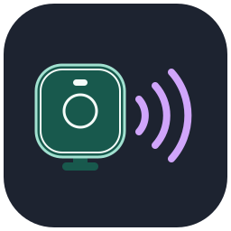
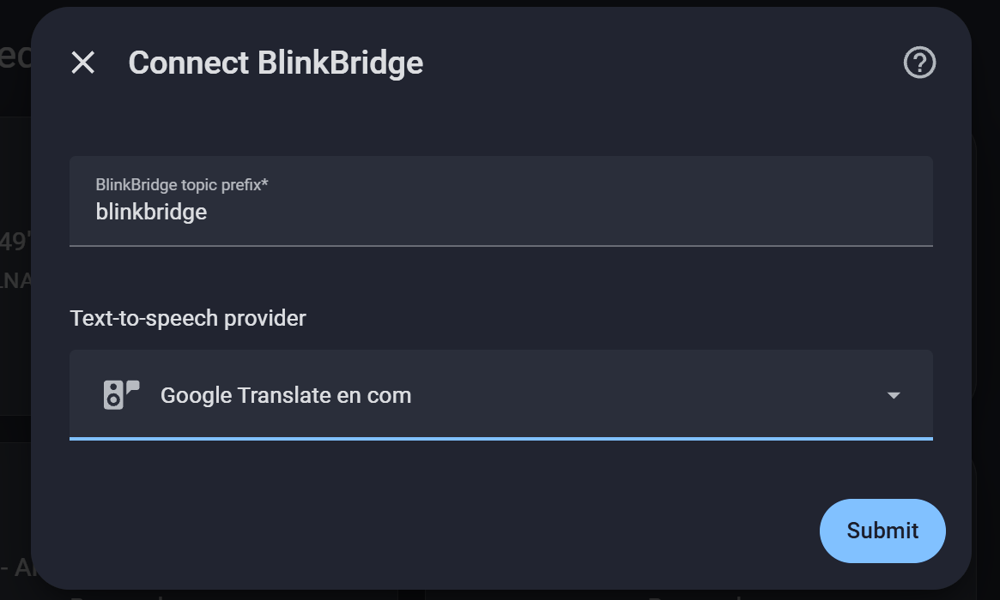
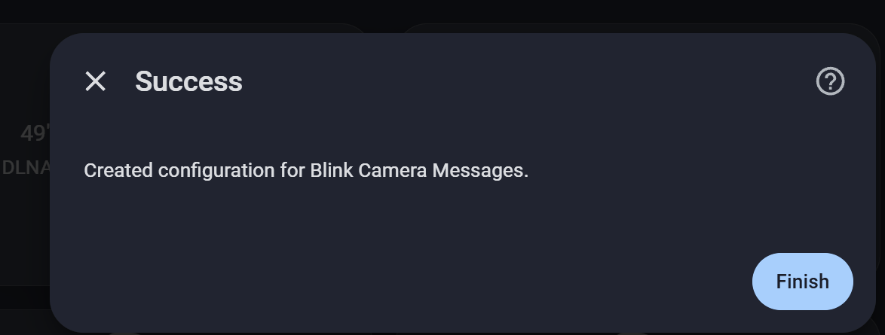
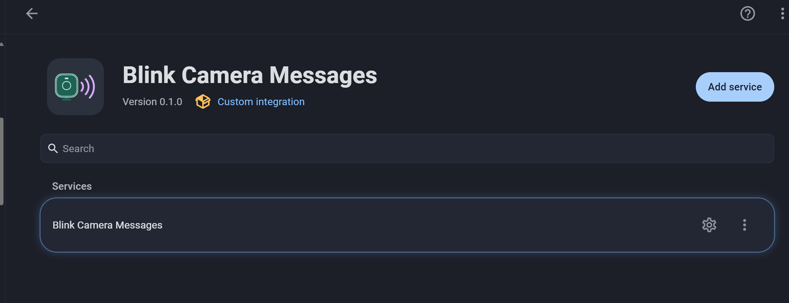
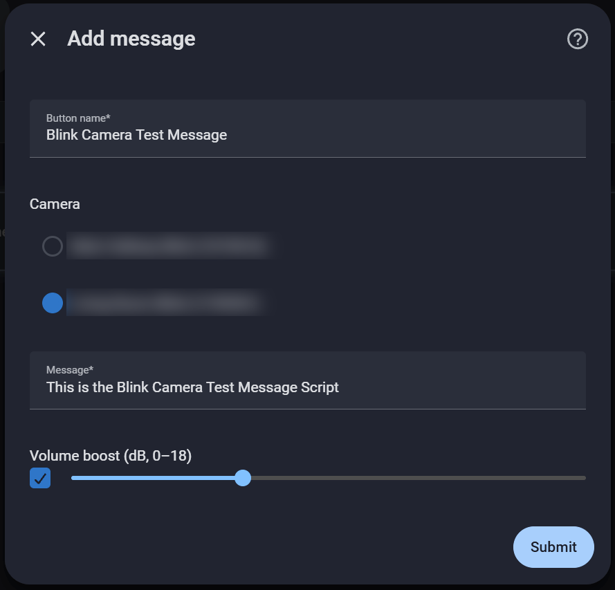
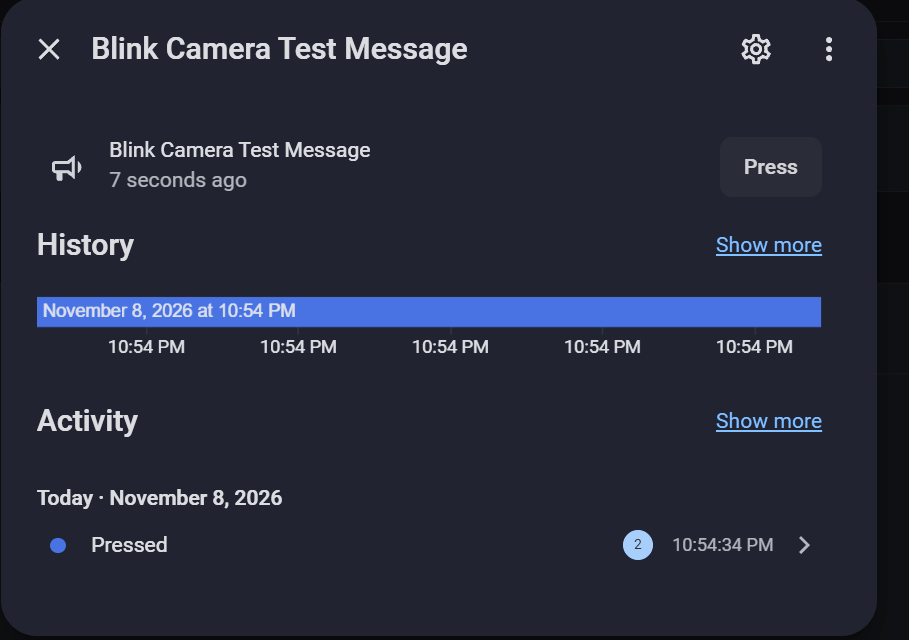

# Blink Camera Messages



Play spoken messages through compatible Blink camera speakers from Home
Assistant. Save a message as a button for your dashboard, or let an
automation play a greeting when Frigate recognizes someone.

Home Assistant generates audio with your chosen text-to-speech (TTS)
provider. It sends the audio over MQTT to BlinkBridge, which plays it
through the camera's active IMMI live-view connection. A saved button stores
the message text, camera and optional volume boost in Home Assistant.

[](https://my.home-assistant.io/redirect/marketplace_repository/?owner=EndOfTheLine-HA&repository=blink-camera-messages&category=integration)

## Requirements

- **Home Assistant 2026.11.0 or newer** with the MQTT integration connected and
  a working TTS entity. Google Translate TTS was used in the setup shown below.
- **BlinkBridge with MQTT speaker support**, running separately and signed in
  to Blink. The Marketplace installs the Home Assistant integration. Set up
  the bridge using the [speaker-enabled BlinkBridge instructions](https://github.com/EndOfTheLine-HA/blinkbridge/tree/2762c2f0b3ed8d3160e6111940d01354b37418df#optional-camera-speaker-playback).
  MQTT speaker support is currently available in this pinned development
  snapshot, not the bridge's default branch or a tagged release. The link
  identifies the tested commit and does not depend on the development branch name.
- **A shared MQTT broker** reachable by Home Assistant and BlinkBridge.
  Restrict writes to the bridge's playback topic to trusted clients.
- **A compatible Blink camera** with an active IMMI live view in BlinkBridge.
  Saved buttons and a Frigate face recognition automation were tested on a
  Blink Mini, with Frigate still receiving video after playback.

Frigate is optional. The built-in Blink integration can coexist with Blink
Camera Messages.

## 1. Enable speaker playback in BlinkBridge

1. Check out the pinned speaker-enabled BlinkBridge snapshot and follow its
   linked setup instructions:

   ```sh
   git clone https://github.com/EndOfTheLine-HA/blinkbridge.git
   cd blinkbridge
   git checkout 2762c2f0b3ed8d3160e6111940d01354b37418df
   ```

   In BlinkBridge's
   configuration, add the camera's exact Blink name to the existing
   `cameras.live` list.
2. For Docker Compose, create `.env.speaker` next to BlinkBridge's
   `compose.yaml`. Use your broker's address and credentials. This example
   uses a broker on port 1883. For TLS, set `BLINKBRIDGE_MQTT_TLS=1` and use
   the port configured on your broker.

   ```dotenv
   BLINKBRIDGE_MQTT_HOST=mqtt.example.net
   BLINKBRIDGE_MQTT_PORT=1883
   BLINKBRIDGE_MQTT_USERNAME=blinkbridge
   BLINKBRIDGE_MQTT_PASSWORD=replace-me
   BLINKBRIDGE_MQTT_PREFIX=blinkbridge
   ```

3. Run `docker compose up -d --build` from the BlinkBridge directory. Verify
   that the target camera is delivering live video before configuring Home
   Assistant.

Home Assistant publishes discovery and playback requests under
`<prefix>/speaker/v1/` and listens for replies under
`<prefix>/speaker/v1/result/+`. Allow about 2.2 MB per MQTT message if you
want to play clips near the duration limit.

## 2. Install and connect in Home Assistant

1. Open **Settings → Marketplace**, search for **Blink Camera Messages**, and
   open its listing. Install the integration and restart Home Assistant.
   If the listing is not available in search yet, use the Marketplace badge
   above or **Add from link** and enter `EndOfTheLine-HA/blink-camera-messages`.
   Select **Integration** if prompted.
2. Go to **Settings → Devices & services → Add integration** and search for
   **Blink Camera Messages**. In **Connect BlinkBridge**, enter the same topic
   prefix you set in BlinkBridge, usually `blinkbridge`. Select your
   text-to-speech provider, then select **Submit**.

   

3. When Home Assistant confirms that it created the configuration, select
   **Finish**.

   

## 3. Save and test a message

1. Open **Blink Camera Messages** under **Settings → Devices & services**.
   Select the gear on the service row, then choose **Add message**.

   

2. Give the button a name, select the camera that should speak, and enter
   the message. Start with a short phrase such as “Hello, welcome home.”
   Text can be up to 240 characters, and the rendered clip can be up to
   17 seconds. If the message sounds quiet, set an optional volume boost
   from 0 to 18 dB. Boost requires FFmpeg on the Home Assistant host and uses
   a peak limiter.

   

3. Select **Submit**, then open the new button entity and select **Press**.
   Listen at the camera to confirm playback. Add the entity to a dashboard
   once it works. Use the same **Configure** menu to edit or remove messages.

   

## Use in automations

To replay a saved message, call **Button: Press** and target its button
entity. This uses the preset's camera, text and volume boost.

```yaml
action: button.press
target:
  entity_id: button.welcome_home
```

Replace `button.welcome_home` with the entity ID Home Assistant assigned.
For example, a Frigate face recognition automation can press this button
when the intended camera recognizes a specific person. Match the camera
and recognized name, require an appropriate confidence score, and add a
cooldown to avoid repeated greetings.

For text that changes at runtime, use **Blink Camera Messages: List cameras**
in **Developer tools → Actions** to find the stable camera ID. Then call
**Speak through Blink camera** with text or a template.

```yaml
action: blink_camera_messages.speak
data:
  camera: "123456789"
  message: "Thank you for the delivery."
```

The [Frigate greeting example](examples/frigate-greeting.yaml) shows the
dynamic-text approach with a face event, explicit name mapping and cooldown.
Replace its example camera names and ID before enabling it.

## Troubleshooting

| Symptom | What to check |
| --- | --- |
| No TTS provider appears | Set up a TTS integration in Home Assistant and confirm its TTS entity is available. |
| Setup reports that no cameras replied | Confirm that BlinkBridge is running with MQTT speaker support, uses the same broker and prefix as Home Assistant, and has a camera configured for live view. Check the broker's topic permissions. |
| The camera is listed but playback reports no active IMMI live view | Verify that BlinkBridge is currently receiving live video from that camera. Try again once the live stream is back. |
| Playback fails or times out | Try a short message without volume boost. Check the action error, Home Assistant logs and BlinkBridge logs for TTS, audio duration, MQTT or camera session errors. BlinkBridge handles one playback request at a time. |
| The button ran but the camera was silent | Check audibility at the camera and try a modest volume boost. A completed request confirms the bridge finished sending audio. |

The setup and preset flow are adapted from
[Ring Camera Messages](https://github.com/EndOfTheLine-HA/ring-camera-messages)
under its MIT license.
